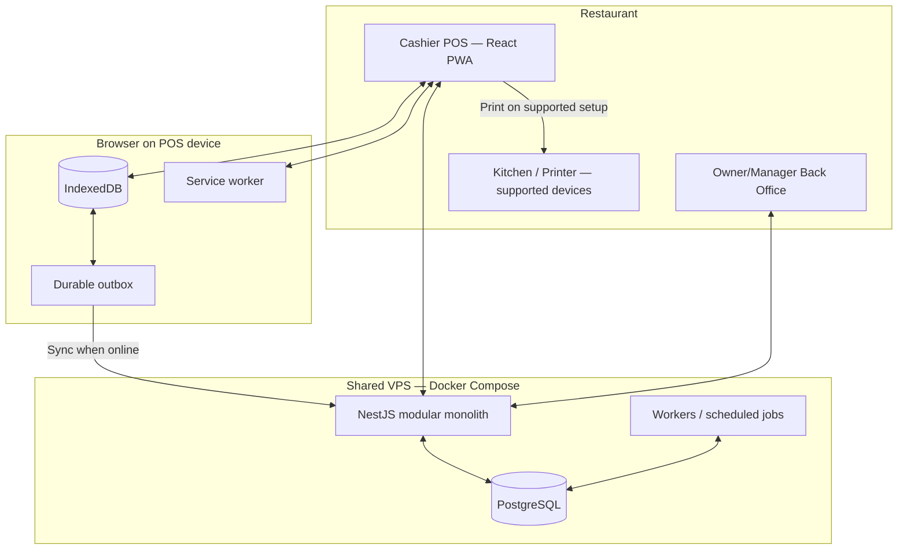
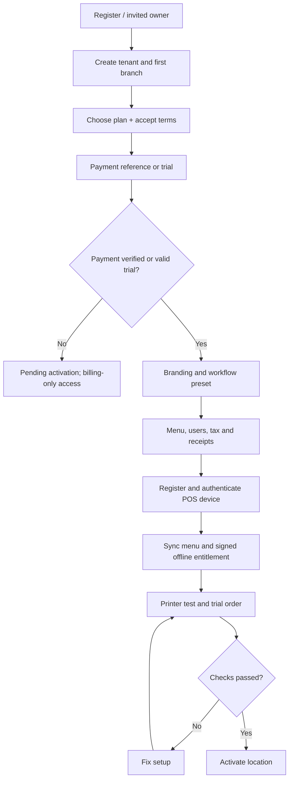
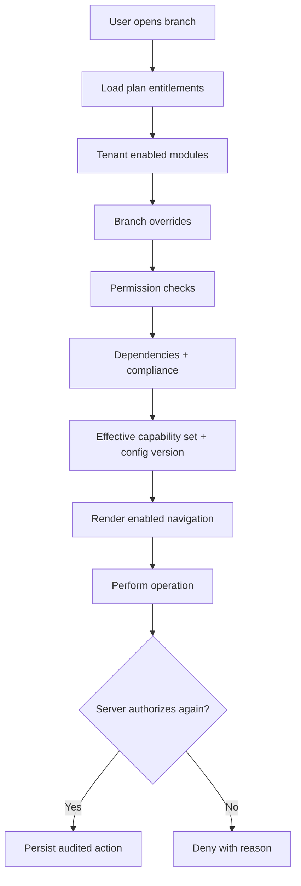
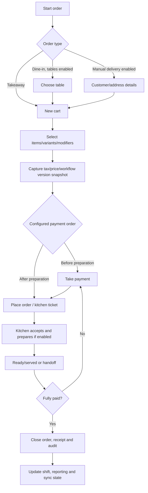
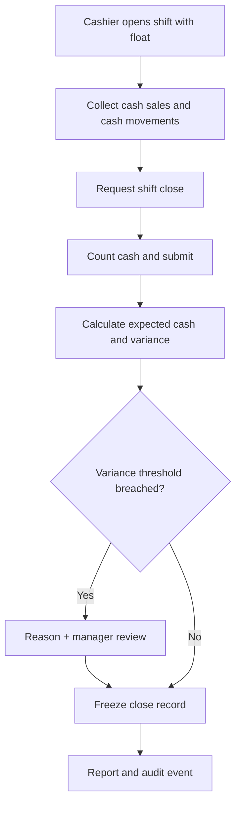
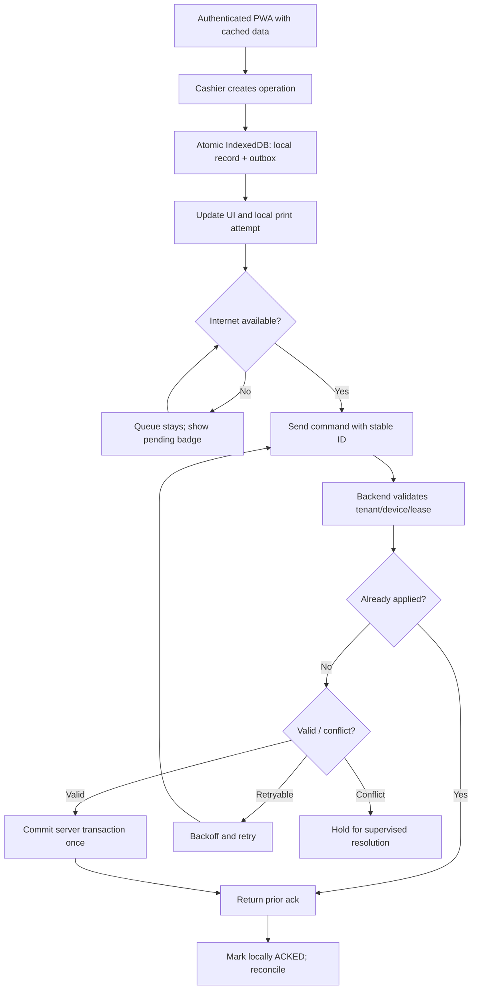
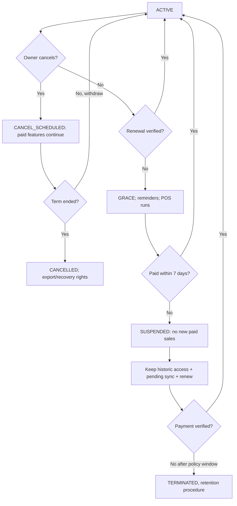
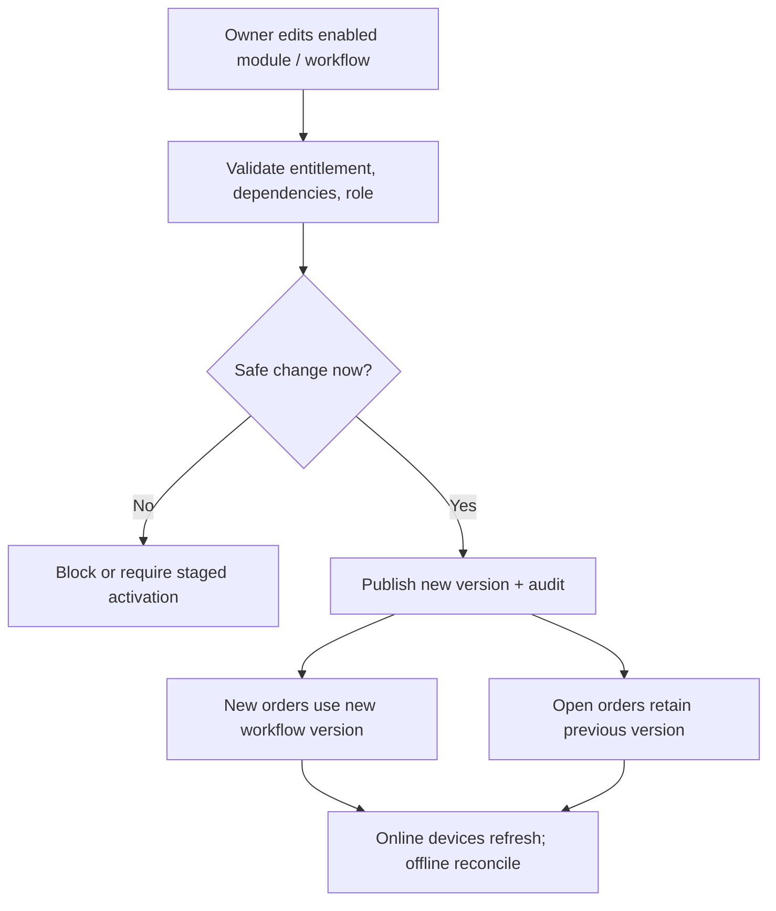
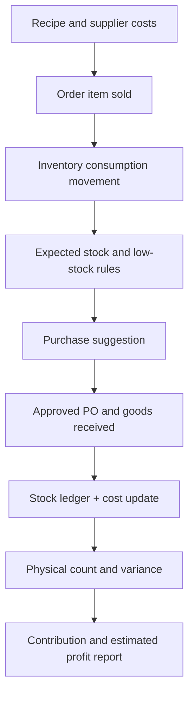
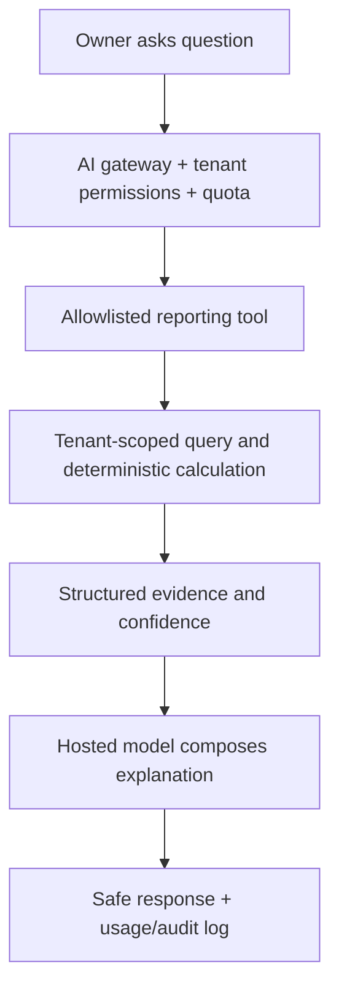

# 02 — Application Flows and User Journeys

All Mermaid diagrams are **target workflow models**, not claims that the functionality currently exists.

## A. System context

No dedicated restaurant server for initial one-counter operation. Online kitchen displays require connectivity; offline multi-terminal coordination is a later capability with its own design and tests.

## B. Tenant onboarding and device activation

## C. Effective module resolution

## D. Order → kitchen → payment → close

Payment and food-preparation states are separate. Refund/void follows authorization and compensating-event workflows, not record deletion. If kitchen module disabled, skip kitchen states safely.

## E. Cash shift close

## F. Offline sync

## G. Cancel vs non-payment

Cancellation at end of term does not initiate a fresh paid month. Pending local work is still accepted under a controlled reconciliation procedure even after suspension.

## H. Config change while orders exist

## I. Inventory & costing (Phase 2)

## J. AI owner chat (Phase 5)

## Unresolved flow questions

Kitchen acknowledgment with browser print only; external card confirmation procedure; tax invoice approval; exact trial/suspension/cancellation notices; multiple cashier terminals per branch. Record decisions in `13-decisions-and-open-questions.md` rather than inventing behavior.
