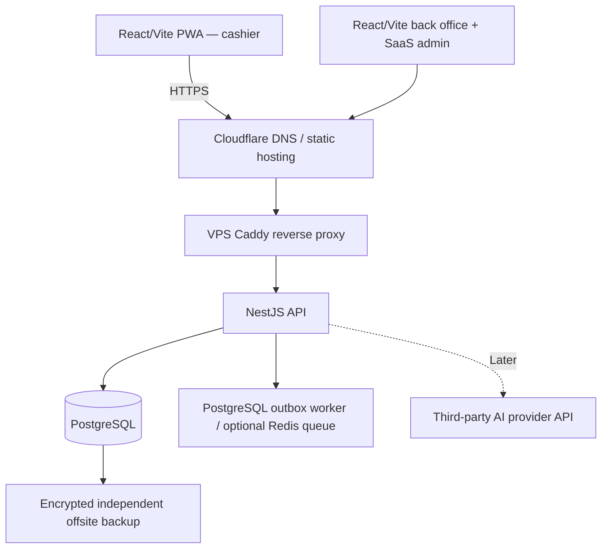

# 03 — Technical Requirements Document (TRD)

## 1. Architecture decision

**One repository, modular monolith, shared VPS, self-hosted PostgreSQL, PWA-first.** Avoid unnecessary cloud subscriptions at 10–20 tenants and target revenue $10–15 per tenant/month. Do not imply that shared VPS capacity is guaranteed without load testing.

### Initial deployment topology



### Stack

| Area | Chosen | Notes |
|---|---|---|
| POS | React + TypeScript + Vite + PWA | Installable where browser supports; offline app shell |
| POS local persistence | IndexedDB with thin versioned storage interface | Native SQLite only if later Tauri |
| Back office and platform admin | React + Vite | Shared design components, tenant-bound access |
| Components | Ant Design + Tailwind (suggested) | Match user-supplied design; token system required |
| API | NestJS + TypeScript | Modular monolith, REST; WebSocket only when justified |
| Data | PostgreSQL + Prisma | Self-managed on shared VPS initially |
| Jobs | DB-backed outbox/polling first; Redis + BullMQ later if needed | Reduce moving parts for $10–15 subscriptions |
| Web hosting | Cloudflare Pages or equivalent | PWA deploy/update requires cache-version control |
| Server | Hetzner or equivalent Linux VPS | 4 vCPU / 8 GB RAM *starting candidate*; benchmark |
| Deploy | Docker Compose + Caddy + GitHub Actions | No Kubernetes initially |
| Logs/metrics | Structured logs, health probes, alerts, error tracking | Redact PII and financial secrets |
| AI (future) | Separate NestJS AI module + provider adapter | Hosted API initially, usage caps per tenant |

## 2. Suggested monorepo layout (to scaffold)

```text
apps/
  pos-pwa/                 # cashier interface + service worker
  backoffice/              # restaurant admin and owner dashboard
  platform-admin/          # SaaS subscriptions and support
  api/                     # NestJS backend
packages/
  ui/                      # reusable branded components and tokens
  domain/                  # shared domain types, use-case policies
  api-contracts/           # DTO schemas, errors, OpenAPI type generation
  offline-core/            # sync state machine and command types
  integrations/            # interfaces, NOT credentials or live services
infra/
  docker/
  deployment/
  monitoring/
  scripts/
prisma/
  schema.prisma
  migrations/
docs/ design/ delivery/ handoff/
AGENTS.md rules.md README.md
```

This repo layout is a proposal; choose a pnpm workspace or equivalent before scaffolding. The `design/` directory is requirements/asset references, not a second application.

## 3. Domain modules within NestJS

`Identity`, `Organizations`, `Branches`, `Devices`, `Catalog`, `Orders`, `Payments`, `Kitchen`, `CashShifts`, `Reports`, `Branding`, `Features`, `Workflows`, `Subscriptions`, `Invoices`, `BillingPayments`, `Sync`, `Audit`, `Integrations`, `Inventory` (P2), `Customers` (P3), `AI` (P5).

Keep cross-module writes transactional where necessary. Prefer domain events persisted in an outbox for side effects. Avoid distributed services until load or isolation demands them.

## 4. Multi-tenant isolation

- Shared database with `tenant_id` on tenant-owned tables and `branch_id` where appropriate.
- Membership and branch assignment validated per request. Query predicates always include tenant scope.
- Apply PostgreSQL Row-Level Security where practical, with tested app-scoped session context; do not assume ORM filters alone are foolproof.
- Compound unique indexes include tenant context (e.g. `(tenant_id, branch_id, order_number)`).
- Tenant-scoped filesystem/object keys, job payloads, logs and AI data. Admin support access audited with least privilege.

## 5. Authentication and authorization

- Online login and protected refresh/session mechanism; per-device enrollment; session/device revoke.
- PWA offline cashier access only for a previously authorized/synced device with a bounded entitlement and cached permissions.
- Role-based + permission-based authorization; effective feature calculation documented in `07-config-white-label.md`.
- Defend against CSRF where cookies are used; secure cookies, strict CORS, brute-force protection and device session expiry.
- Offline PIN is an optional convenience control, not a replacement for backend authentication.

## 6. Transaction and currency conventions

- Money as integer PKR minor units (paisa) with explicit tax/rounding; amounts are immutable per finalized order entry.
- IDs: UUID or ULID, generated offline where necessary. Server-issued sequential receipt reference only after accepted transaction, subject to fiscal policy.
- Store UTC timestamps and local timezone identifier; display local time. Avoid using client clock to assert canonical ordering.
- Financial records: append/audit corrections; external payment verification status separate from cashier-entered tender type.

## 7. PWA and offline scope

- Service worker caches versioned app shell and non-sensitive static assets; IndexedDB stores scoped menu, device session metadata, order snapshots and durable command outbox.
- Network-first where fresh data is essential, with explicit offline fallback. Migrations cannot discard unsynced data.
- Command sync must be retry-safe and idempotent; see `06-offline-sync-printing.md`.
- Device and local data recovery considered operational risk: persisted browser storage may still be cleared or evicted.
- No implied multi-device LAN consistency or offline cloud payments. This is **single-terminal offline-first**.

## 8. Performance and resilience objectives (provisional)

- Target PWA responsive interactions during typical cashier peak without blocking on network; establish measurable budget after device testing.
- API p95 latency target to be benchmarked on Pakistan connections and target hosting regions; don't commit a number without measurement.
- Tests: network loss mid-payment, replay commands, process crash between local write/sync, duplicate webhooks, DB restore, PWA update during active shift.
- Initial single VPS is a **single point of failure**. Backups and restore drill required before first paid pilot.
- Simulate 10–20 restaurants with concurrent peak usage; include reporting and synchronization bursts, not merely simple GET tests.

## 9. CI/CD and migrations

- Pull request checks: format, lint, types, unit, integration, tenant isolation and financial invariants.
- Versioned database migrations; backward-compatible changes before application rollout; avoid destructive schema migrations.
- Build immutable backend image; deploy with Docker Compose; readiness checks, structured rollback instructions.
- Frontend caches and IndexedDB versions need migration planning; users may have stale PWA clients for days.
- Secrets in deployment environment/secret store, never committed.

## 10. Future Tauri and AI readiness

Define `StorageAdapter`, `PrinterAdapter`, `DeviceAdapter`, `SyncTransport` interfaces; React UI/domain remains portable. Tauri integration later replaces adapters and may use SQLite but does not magically solve all local multi-device coordination.

AI gateway later should expose allowlisted tools over the same domain APIs with tenant/branch authorization, budgets, logging, human confirmation for writes and optional pgvector for approved retrieval. No GPU/VPS requirement for the MVP.
