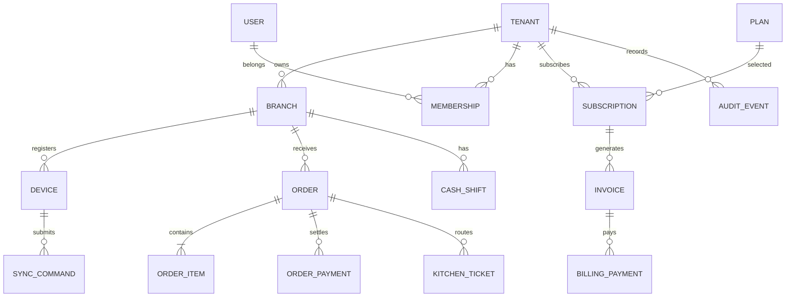

# 04 — Database Schema and Data Model

**Design status:** Logical schema v1; exact columns and relations must be validated in implementation migrations. Avoid treating these as an existing database. PostgreSQL + Prisma on a shared VPS.

## 1. Entity hierarchy

**Important naming convention:** `billing_payments` pay **our SaaS invoices**. `order_payments` pay **restaurant customer orders**. Never merge or report these as one ledger.

## 2. Core tables (MVP)

**Identity and tenancy**

| Table | Key fields and constraints |
|---|---|
| `tenants` | `id`, `legal_name`, `display_name`, `status`, `default_timezone`, `created_at` |
| `branches` | `id`, `tenant_id`, `name`, `address`, `active`, `timezone`, unique `(tenant_id, name)` as appropriate |
| `users` | `id`, `email` nullable, `phone` nullable, `password_hash` if password auth, `status`, timestamps |
| `memberships` | `id`, `tenant_id`, `user_id`, `status`, uniqueness `(tenant_id,user_id)` |
| `roles` | `id`, `tenant_id` nullable for system template, `slug`, unique within applicable scope |
| `permissions` | `id`, `key` (e.g. `orders.refund`) |
| `role_permissions` | `role_id`, `permission_id` compound unique |
| `membership_role_assignments` | `membership_id`, `role_id`, `branch_id` nullable; unique effective assignments |
| `devices` | `id`, `tenant_id`, `branch_id`, `device_public_id`, `status`, `last_seen_at`, `revoked_at` |
| `sessions` | `id`, `user_id`, `device_id` nullable, `expires_at`, `revoked_at`, secret token hash only |

**Brand, plan and workflow configuration**

| Table | Key fields and constraints |
|---|---|
| `tenant_branding` | `tenant_id` unique, `logo_asset_key`, `colors_json`, `receipt_header`, `receipt_footer`, `config_version` |
| `feature_definitions` | `key` unique, `status`, `dependencies_json`, `mandatory` |
| `plans` | `id`, `code`, `currency`, `price_minor`, `term_months`, `status` |
| `plan_entitlements` | `plan_id`, `feature_key`, `enabled`, `usage_limit`, unique `(plan_id,feature_key)` |
| `tenant_features` | `tenant_id`, `feature_key`, `enabled`, version; unique pair |
| `branch_features` | `tenant_id`, `branch_id`, `feature_key`, `enabled`, version; unique triple |
| `workflow_config_versions` | `id`, `tenant_id`, `branch_id` nullable, `template_code`, `config_json`, `version`, `effective_at`, `published_by` |
| `entitlement_snapshots` | `id`, `tenant_id`, `device_id`, `issued_at`, `expires_at`, `payload_hash`, `key_id`, `revoked_at` |

**Catalog, taxes, orders, kitchen and payments**

| Table | Key fields and constraints |
|---|---|
| `tax_profiles` | `id`, `tenant_id`, `jurisdiction`, `rules_json`, `effective_from`, `effective_to` nullable |
| `menu_categories` | `id`, `tenant_id`, `name`, `position`, `archived_at` |
| `menu_items` | `id`, `tenant_id`, `category_id`, `name`, `sku`, `active`, `tax_profile_id` |
| `item_variants` | `id`, `tenant_id`, `item_id`, `name`, `base_price_minor`, `active` |
| `modifier_groups` | `id`, `tenant_id`, `name`, `min_select`, `max_select` |
| `modifier_options` | `id`, `tenant_id`, `group_id`, `name`, `price_delta_minor` |
| `item_modifier_groups` | `item_id`, `group_id`, required constraints |
| `tables` | `id`, `tenant_id`, `branch_id`, `label`, `seats`, `status` (module enabled only) |
| `orders` | `id` client-generated, `tenant_id`, `branch_id`, `device_id`, `shift_id`, `table_id` nullable, `type`, `status`, `workflow_version_id`, `total_minor`, `currency`, timestamps |
| `order_items` | `id`, `tenant_id`, `order_id`, `item_id` nullable, `variant_id` nullable, `snapshot_json`, `quantity`, `unit_price_minor`, `tax_minor`, `discount_minor`, `line_total_minor` |
| `order_events` | `id`, `tenant_id`, `order_id`, `type`, `payload_json`, `actor_id`, `occurred_at`, `recorded_at` |
| `order_payments` | `id`, `tenant_id`, `order_id`, `method`, `amount_minor`, `verification_status`, `external_ref` nullable, `recorded_by`, `verified_by` nullable |
| `refunds` | `id`, `tenant_id`, `order_payment_id`, `amount_minor`, `reason`, `approved_by`, `status`, timestamps |
| `kitchen_tickets` | `id`, `tenant_id`, `branch_id`, `order_id`, `station`, `status`, `printed_at` nullable, `attempts` |
| `cash_shifts` | `id`, `tenant_id`, `branch_id`, `device_id`, `cashier_id`, `opened_at`, `closed_at`, `opening_float_minor`, `expected_minor`, `counted_minor`, `difference_minor`, `status` |
| `cash_movements` | `id`, `tenant_id`, `shift_id`, `type`, `amount_minor`, `reason`, `actor_id` |
| `receipt_records` | `id`, `tenant_id`, `order_id`, `receipt_no`, `fiscal_status`, `print_count`, `payload_snapshot_json` |

**Subscriptions, audit and sync**

| Table | Key fields and constraints |
|---|---|
| `subscriptions` | `id`, `tenant_id`, `plan_id`, `status`, `current_period_start`, `current_period_end`, `cancel_at_period_end`, `grace_until`, `suspended_at`, timestamps |
| `invoices` | `id`, `tenant_id`, `subscription_id`, `period_start/end`, `amount_minor`, `currency`, `status`, `due_at`, `paid_at` |
| `billing_payments` | `id`, `tenant_id`, `invoice_id`, `method`, `amount_minor`, `reference`, `status`, `verified_by`, `verified_at` |
| `billing_events` | `id`, `tenant_id`, `subscription_id`, `type`, `details_json`, `actor_id`, `created_at` |
| `sync_commands` | `id` command UUID, `tenant_id`, `branch_id`, `device_id`, `type`, `schema_version`, `payload_json`, `status`, `response_json`, `server_received_at`, unique `(tenant_id,device_id,id)` |
| `outbox_events` | `id`, `tenant_id`, `aggregate_type`, `aggregate_id`, `type`, `payload_json`, `processed_at`, `attempt_count` |
| `audit_events` | `id`, `tenant_id`, `branch_id` nullable, `actor_id`, `device_id`, `action`, `entity_type`, `entity_id`, `before_json` nullable, `after_json` nullable, `occurred_at` |

## 3. Later-phase extension tables

- **Inventory (P2):** `ingredients`, `units`, `recipes`, `recipe_versions`, `recipe_components`, `inventory_locations`, `inventory_movements`, `stock_counts`, `stock_adjustments`, `suppliers`, `purchase_orders`, `purchase_order_lines`, `goods_receipts`, `expenses`.
- **Growth (P3):** `customer_profiles`, `customer_consents`, `delivery_zones`, `online_orders`, `loyalty_accounts`, `loyalty_ledger`, `campaigns`.
- **Multi-branch / compliance (P4):** `stock_transfers`, `integration_connections`, `integration_jobs`, `fiscal_invoice_submissions`, `settlements`, `settlement_matches`.
- **AI (P5):** `ai_usage_ledger`, `ai_tool_audit`, `ai_conversations`, `ai_message_summaries`; store only necessary content, apply tenant retention.

## 4. Constraints and invariants

1. All tenant-owned foreign keys must point to entities from the **same tenant**; use composite keys/checks or transactional validation, not only UI filtering.
2. `order_items` store a **historical price/tax/modifier snapshot**; changing current menu must not alter past sales.
3. Order totals and settlement allocations use integer minor units. Discounts never exceed eligible base; total/refunds validated atomically.
4. `sync_commands` are idempotent and have an immutable result after accepted application; repeat requests return the original result.
5. Subscription lifecycle and restaurant customer payments live in separate bounded contexts.
6. Effective config version is referenced by orders and synced devices; disabling a module cannot destroy its history.
7. Use indexes for `(tenant_id,branch_id,created_at)` on high-volume tables and `(tenant_id,status,created_at)` for work queues; refine based on EXPLAIN and load tests.
8. Avoid automatically deleting accounting records. Retention/deletion policy needs legal review and verified export support.

## 5. Prisma implementation guidance

- Place tenant context in request-scoped service methods; avoid unaudited generic repositories that allow cross-tenant queries.
- Use database transactions for monetary writes and command application. Guard against race conditions using unique constraints and conditional updates.
- For RLS, design tested session-scope context, pooling and migration privileges; Prisma defaults alone do not enable RLS.
- Maintain migration history and fixtures; never `db push` or `migrate reset` in production.
- Order numbers visible on receipts may be generated centrally; offline devices need provisional local references with safe post-sync reconciliation.
