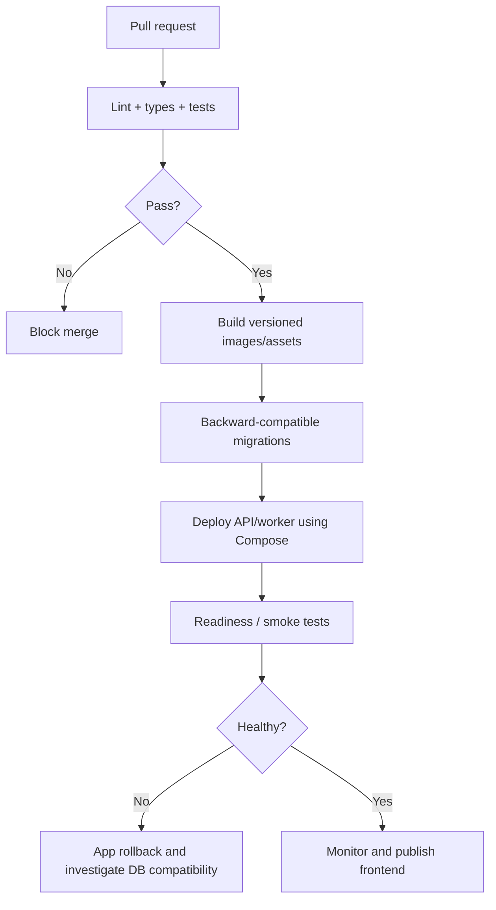

# 11 — Deployment, Infrastructure, Backups and Operations

## Target topology

Single cost-conscious Linux VPS (Hetzner candidate) running NestJS API and workers, self-hosted PostgreSQL and optionally Redis with Docker Compose. Static React PWA and back-office may be hosted via Cloudflare Pages; Caddy terminates TLS/HTTP at the VPS. One SaaS application serves all restaurants. A local restaurant server is not required for **single-terminal** operation.

## Infrastructure budget posture

- Target selling price ~$10–15 per restaurant/month; at 10 restaurants MRR ~$100–150, at 20 ~$200–300, **before all expenses**.
- Initial VPS candidate 4 shared vCPU / 8GB RAM. Host prices vary by region, date, CPU class and backup/IPv4 cost; verify before purchase.
- Self-hosted PostgreSQL avoids Supabase Pro fee but introduces operations, monitoring, patching, recovery and backup responsibilities.
- Budget independent backup storage, domain/IPv4, email/SMS/WhatsApp messages, monitoring, support, staff time and potential tax/payment integration charges separately.
- Do **not** buy a GPU machine for future AI at launch; use managed model APIs when later justified, with tenant-specific spending caps.

## Compose services

- `api`: NestJS HTTP server; stateless except DB and job queues.
- `worker`: outbox processing, subscription cron/workflows, exports.
- `postgres`: persistent volume, private network, backup and restore operations.
- `caddy`: reverse proxy and HTTPS; optional frontend asset serving.
- `redis`: **optional** until actual job throughput justifies it; prefer DB-backed outbox for MVP durability.
- `monitoring`: error alerts, probes and logs, selected based on actual budget.

## Provisioning checklist

1. Provision VPS and DNS; restrict inbound ports to 80/443 and secured SSH.
2. Create non-root deployment account, SSH key auth, firewall, unattended security updates, automatic reboot policy.
3. Configure volumes, database role credentials, connection pool, TLS, secrets outside repository.
4. Install Docker/Compose, proxy, API and worker using versioned image tags.
5. Set up alerting for service failure, high disk/CPU, DB health, backup freshness, outbox lag and failed invoices/sync.
6. Set up independent encrypted PostgreSQL backups with retention and access controls.
7. Test restoring an actual backup in an isolated environment; record restoration time and data loss bound.
8. Deploy CI/CD and migration strategy; verify rollback does not require dangerous down-migrations.
9. Test from Pakistani networks, including intermittent connections and region latency.

## Backups

- Use PostgreSQL-consistent backups (`pg_dump` for early small DB or WAL-aware physical backups as scale requires), encryption, offsite storage and verification.
- Proposed starting policy: daily full backups + more frequent WAL/PITR only when operationally implemented and monitored; choose RPO/RTO based on actual business acceptance.
- Database backups do **not** rescue client-only orders that never synced. Local unsynced data requires independent mitigation and support runbook.
- Never restore production DB over live service without an incident plan; test restores monthly or as contract requires.

## Deployment pipeline

## Scale-out triggers

When metrics show resource pressure, first tune queries/indexes, pagination and background report workloads; then vertically resize VPS; then move PostgreSQL to separate VPS/managed service and scale API instances. Only add queue servers, read replicas or microservices when justified by measured limits. Single VPS remains a single point of failure until redundancy is deliberately built.

## Owner-visible operational status

Back office should show device online/offline, last sync, pending command count, failed prints, last server confirmation and subscription status. Admin should monitor sync backlogs per tenant without unrestricted customer data browsing.

## Operational runbooks to add during implementation

`infra/operations/restore.md`, `incident.md`, `deploy.md`, `printer-support.md`, `device-reset.md`, `subscription-manual-verification.md`. These are **planned future files**, not present yet.
