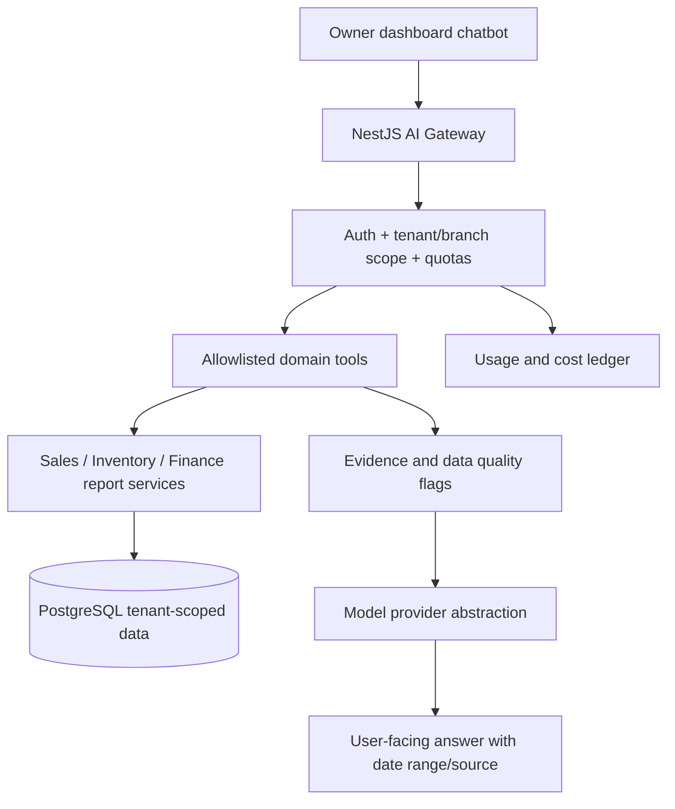

# 14 — Future AI Architecture and Feature Plan

**Phase 5 only.** No model calls, external AI subscription, vector DB, GPU or LLM agent in MVP. Build the core business domain so AI can be added without invasive refactoring.

## Use cases in priority order

1. **Owner Q&A over trusted metrics:** "What were net sales yesterday?" "Which items sold most?" "Which branches had unusual refunds?"
2. **Cost/profit explanations:** Only after recipe costs, expenses and fee data are reliable; label estimated versus confirmed.
3. **Inventory reorder suggestions:** Based on current stock, recipe consumption, lead times and forecast; manager approval before purchase order creation.
4. **Demand forecasting and seasonality:** Item/date forecasts with confidence ranges and backtests.
5. **Operational anomaly alerts:** Structured rules first, ML later; avoid accusatory labels about staff without evidence.
6. **Menu import helper:** OCR/document parsing and manager approval for new catalog items, without automatic publication.

## Proposed module boundary

## APIs/interfaces to plan early (do not implement until needed)

- `AIProvider.generate({ messages, toolSchemas, tokenBudget })` without hard-coded vendor in core domain.
- `BusinessToolRegistry`: tools like `get_sales_summary(tenant, branches, range)`, `get_item_margins(...)`, `get_low_stock(...)`; tenant context injected by trusted server, not accepted from user-provided prompt.
- `AIUsageLedger`: `tenant_id`, `user_id`, `feature`, `model`, `input_tokens`, `output_tokens`, `estimated_cost_minor`, `request_status`, timestamps.
- `AiTenantPolicy`: feature enabled, monthly request/token quota, daily ceiling, allowed models and data access policy.

## Safety and data correctness

- No arbitrary natural-language-generated SQL against production databases; use read-only, validated domain tools.
- Tenant isolation tested in every tool; respect branch membership and feature entitlements.
- Use deterministic calculations for money, tax, inventory quantities and margins. LLM writes narrative, not accounting facts.
- Record time range, data freshness, pending offline-sync effects, input source and estimated cost; disclaim approximate profit when cost data incomplete.
- Require explicit human confirmation and audit for actions such as changing menu price, creating a purchase order or sending customer campaigns.
- Protect against prompt injection in menus, customer notes and uploaded files; treat these as data, not instructions.
- Define data retention and customer consent for LLM providers, and avoid sending unnecessary PII to external models.

## Launch economics

At the target $10–15/month per restaurant, AI should initially be a separate add-on or tightly metered entitlement, not unlimited bundled chat. Track model spend, retries and utilization per tenant; add provider-level limits to prevent accidental cost overruns. No need for self-hosted model inference until cost and usage justify it.

## Readiness checklist (from earlier phases)

- [ ] Structured, authoritative sales and payment reporting API
- [ ] Tenant and branch RBAC enforced on reports
- [ ] Immutable source events and fresh sync status
- [ ] Recipe/expense cost data quality indicators (Phase 2)
- [ ] Feature entitlement system supports AI add-ons and quotas
- [ ] Auditing and deletion/retention policies established
- [ ] Benchmarks confirm model spend fits add-on price

## When implementing

Create new milestone P5 with acceptance tests for cross-tenant access, prompt injection, incorrect financial totals, unavailable model provider, expensive runaway conversations and partial offline data. Update PRD, schema, security, design and billing docs. Never treat AI recommendations as a substitute for proven inventory/financial controls.
